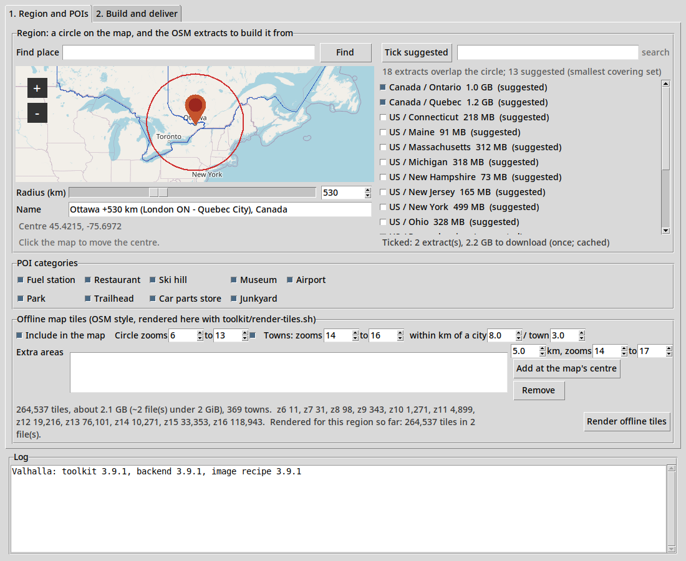
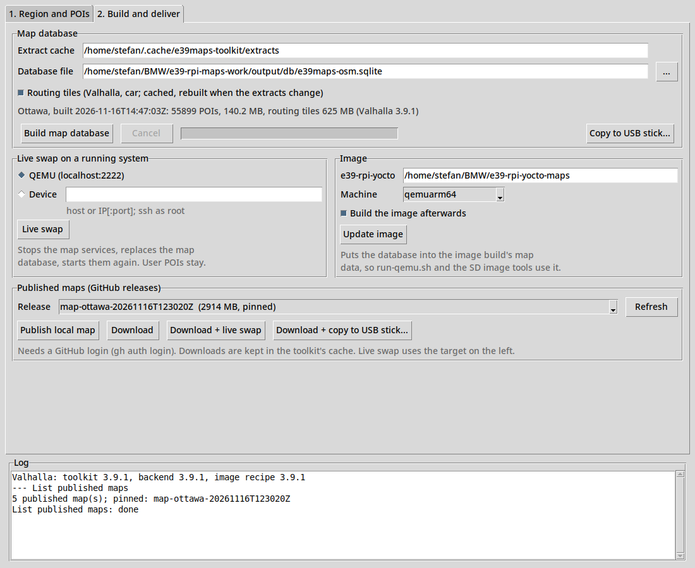

# e39-rpi-maps

The maps backend of the [e39-rpi](https://github.com/linster/e39-rpi) HMI
(the BMW E39's screen on a Raspberry Pi running Yocto Linux), and the
**map toolkit** that builds its maps on a laptop. Everything works
offline in the car:

- **POIs**: the user's own (editable) and the map's (fuel stations,
  restaurants, parks, ... from OpenStreetMap), searched near a point, in an
  area or by name.
- **Routing**: turn-by-turn routes from Valhalla, in-process, on the map's
  routing tiles.
- **Map tiles**: pre-rendered offline tiles in OSM's style, a cache, and
  tile.openstreetmap.org when online.
- **Geocoding**: addresses (free text or a contact's card) to positions.
- **Time zones**: the zone at a position, so the car's clock follows it
  across zone borders.

The HMI talks to it over **gRPC** (POIs, routes, geocoding) and **HTTP**
(tiles). It's a Django **5.0.11** app (the Yocto image's version) with
**two SQLite databases**: the read-only map, replaced as a whole on a map
update, and the writable state (users, the user's POIs). See "Databases".
Packaged for the car by e39-rpi-yocto's `meta-e39rpi-maps` layer.

## Quick start

```sh
python3 -m venv .venv
. .venv/bin/activate
pip install -r src/requirements/base.txt

cd src
python manage.py migrate
python manage.py runserver
```

- Page: <http://127.0.0.1:8000/>
- Health probe: <http://127.0.0.1:8000/healthz>
- Admin: <http://127.0.0.1:8000/admin/>, user **`admin`**, password
  **`e39rpi`**: in development (`DJANGO_DEBUG=1`, the default) `migrate`
  creates that account if it's missing (`DJANGO_DEV_ADMIN`, see
  `.env.example`; never overwritten, so a changed password stays). Production
  gets none unless `DJANGO_DEV_ADMIN` is set; the Yocto image sets it for
  development images (`debug-tweaks`) only.

Run the tests with:

```sh
python manage.py test
```

The gRPC API for the HMI (next section) runs as its own process:

```sh
python manage.py run_grpc_server     # 0.0.0.0:50051, DJANGO_GRPC_BIND
```

## Map toolkit

`toolkit/` builds the **map database** on the laptop and gets it onto a
device. It isn't part of the app installed on the device.

```sh
toolkit/map-toolkit-container.sh          # the window, in a container (podman or docker)
toolkit/map-toolkit-container.sh --help   # the same as commands: build, info, push, usb, update-image,
                                          #   publish, releases, pin, fetch, render-*
toolkit/map-toolkit.sh                    # or without a container: creates toolkit/.venv
```

**The container** (`toolkit/Dockerfile`, Python 3.12, Tk, ssh/sshpass,
pyosmium, pyvalhalla) always has the pinned Valhalla, whatever the laptop
has; it's built on first use and when `toolkit/requirements.txt` or the
Dockerfile change (tagged `e39maps-toolkit:valhalla-<version>-<hash>`,
~530 MB). The toolkit's code is mounted from this checkout (no rebuild for
code changes), and so are its cache, settings, `~/.ssh` (read-only) and the
e39-rpi-yocto checkout, at the same paths as on the host; files it writes
are yours (rootless podman `--userns=keep-id`, docker `--user`). Host
network (QEMU's `localhost:2222`, downloads) and the host's X display.
"Update image" needs bitbake on the host: the launcher keeps a helper
running that starts the image build there when the toolkit asks (a request
file in a shared directory). Inside the container the routing tiles are
copied beside the database rather than hard-linked from the cache
(different mounts), so they take 625 MB more disk.



- **Region** (tab 1): an OpenStreetMap map with the circle on it: click to
  move the centre, the slider or box for the radius, "Find" for a place
  name (Nominatim). Next to it, a checklist of Geofabrik's extracts the
  circle overlaps (from Geofabrik's index of extracts and their outlines,
  cached for a week), with download sizes; ticked ones are outlined on the
  map. "Suggested" marks the smallest set covering the circle: each point of
  the circle goes to the smallest extract containing it, so Ontario rather
  than Canada, New York rather than "US Northeast". Ticks stay when the
  circle moves (leave out the US for a Canada-only map); "Tick suggested"
  applies the suggestion; the search box finds any other extract.
- **Build map database**: downloads the OpenStreetMap extracts of the region
  from Geofabrik (cached in `~/.cache/e39maps-toolkit/extracts`, refreshed
  when Geofabrik has newer ones, MD5-checked), keeps the POIs of the chosen
  categories inside the region's circle, adds the region's time zone
  boundaries and its addresses for geocoding (a second pass over the
  extracts; see [Geocoding](#geocoding)), and writes
  `output/db/e39maps-osm.sqlite`. Ottawa + 530 km takes about 11 minutes
  and 7 GB of memory with cached extracts and routing tiles; the database
  is 140 MB. Default region: centred on Ottawa, 530 km,
  reaching London ON and Quebec City; Canada only (the Ontario and Quebec
  extracts, ~2.2 GB). Categories: fuel stations, restaurants (incl. fast
  food), ski hills, museums, airports, parks, trailheads, car parts stores,
  junkyards (OSM tags: `toolkit/e39maps_toolkit/categories.py`). Named
  objects only, except fuel stations and car parts stores (brand/operator
  instead).
- **Companion files**: a map is the database plus the files it names
  (`mapdata.schema.companions`): its routing tiles and its offline map
  tiles. Every route checks them all (size, SHA-256) and installs them
  together; the device keeps them as `e39maps-routing.tar` and
  `e39maps-tiles-NN.mbtiles` beside the database.
- **Routing tiles** (on by default): Valhalla's car-only road network for
  the extracts (all of Ontario and Quebec: ~625 MB, ~5 minutes, ~13 GB of
  RAM), built with pyvalhalla's `valhalla_build_tiles` and cached (rebuilt
  only when the extracts or the Valhalla version change). They're written
  beside the database as `e39maps-osm.routing.tar`, and the database
  records their size, SHA-256 and Valhalla version: the two files are one
  map version and always travel together (push, USB, image), checked
  before they're installed.
- **Offline map tiles** (tab 1, "Offline map tiles"): raster tiles in
  OpenStreetMap's own style, rendered on the laptop by
  `toolkit/render-tiles.sh` (the "Render offline tiles" button runs it):
  the toolkit container clips the extracts to the circle and merges them
  (osmium-tool), the `overv/openstreetmap-tile-server` container (2.3.0:
  PostGIS, osm2pgsql, Mapnik, openstreetmap-carto) imports that into a
  PostGIS volume (`e39maps-osm-db`; once per region/extracts, ~1-2 h, tens
  of GB) and serves tiles, and the toolkit fetches the planned tiles into
  MBTiles files (`tiles-NN.mbtiles` in `~/.cache/e39maps-toolkit/render/
  <region key>/`, a new file every ~1.9 GB: GitHub's release asset limit;
  resumable). Default plan: the circle at zooms 6-13 plus zooms 14-16 within
  8 km of cities and 3 km of towns (OSM place=city/town), configurable,
  with extra areas and a live tile/size estimate (Ottawa + 530 km: 264,537
  tiles in two files, 2.3 GB). The next "Build map database" includes them: the files
  are companions of the database like the routing tiles (names, sizes,
  SHA-256 in its facts) and travel with it everywhere (live swap, USB,
  image, releases). The backend serves them first (`/tiles/...`, source
  `mbtiles`).


- **Live swap** (QEMU on `localhost:2222`, or a device's host/IP): copies
  the database over ssh next to the installed one, then the device's
  installer (`e39maps-mapdb`, Yocto layer) checks it, stops the services
  using the map database, swaps it in and starts them again. The state
  database (users, the user's POIs) isn't touched.
- **Update image**: copies the database to where the Yocto build reads the
  map data (the e39-rpi-maps submodule's `output/db` in e39-rpi-yocto, or
  `E39_MAPS_DATA_DIR` from its `local.conf`) and starts the image build
  (qemuarm64 or raspberrypi4-64) with its progress window, so `run-qemu.sh`
  and the SD card tools use an image with this map.
- **Published maps** (GitHub releases; log in once with `gh auth login`):
  **Publish local map**, then pick a release to **Download**, **Download +
  live swap** or **Download + copy to USB stick** (commands: `publish`,
  `releases`, `pin TAG`, `fetch`, `push --release TAG`, `usb DIR [--release TAG]`).
  Releases are named after the region's city and pinning picks the one
  images ship (see [Pinning](#pinning-which-map-images-ship)).
  Downloads are checked against the release's `map-release.json` (SHA-256)
  and kept in `~/.cache/e39maps-toolkit/published/<tag>`.
- **USB stick** (no laptop needed): put the database and its companion
  files (routing tiles, map tiles) in a folder `RPIMAPS` on a stick
  ("Copy to USB stick..." does that) and plug it into the device;
  they're checked and installed, then renamed on the stick to
  `<name>.copied-<date-time>` (invalid files: `.rejected-...`; older ones
  next to a newer: `.skipped-...`).

The file format is `src/mapdata/schema.py`, shared by the toolkit, the
backend and the device's installer: SQLite with `application_id` "E39P" and
`user_version` = format version, `e39maps_meta` facts (`built_at`,
`region`, `poi_count`, the extracts' OSM timestamps, ...), `map_poi`,
`timezone_area` and the geocoding tables (see [Geocoding](#geocoding)).
Maps built before a table was added still load; what needs it answers
"unavailable".

**Time zones in the map.** The fact `timezone` is the zone at the circle's
centre (the device's zone when it has no position). `timezone_area` holds
the zone boundaries of the region, so the device can follow the car across
them (e39-rpi-yocto's `e39maps-timezone-follow`, from gpsd):

- Source: [timezone-boundary-builder](https://github.com/evansiroky/timezone-boundary-builder)
  release **2026e** (`timezones.geojson.zip`, every zone, e.g.
  America/Toronto rather than New_York, which the `-now` variant would
  merge it into), pinned with its SHA-256 in
  `toolkit/e39maps_toolkit/timezones.py`. Keep the release in step with the
  image's tzdata (e39-rpi-yocto `e39rpi-timezone-version.inc`), so every
  zone it names exists on the device.
- Downloaded once into `~/.cache/e39maps-toolkit/timezones/` and checked.
  Building reads all of it (172 MB of GeoJSON, ~1.5 GB of memory, ~30 s).
- Clipped to the circle + 20 km and simplified to ~100 m with
  `shapely.coverage_simplify`, which keeps shared borders identical (no gaps
  or overlaps between zones). Ottawa + 530 km: 4 zones, 79 kB.
- Facts: `timezone_areas` (rows) and `timezone_boundaries` (the release).
- Looked up by `mapdata.timezones.zone_at` (pure Python, no shapely: the
  device imports it): bounding boxes in SQL, then ray casting with holes. A
  point on a shared border belongs to exactly one zone. Outside every area
  (or a map built before `timezone_area`) it answers the map's `timezone`.
  The backend serves it as `GET /timezone?lat=..&lon=..` →
  `{"zone": ..., "source": "boundaries" | "map-centre"}`.
Toolkit tests: `PYTHONPATH=toolkit:src toolkit/.venv/bin/python -m unittest
discover -s toolkit/tests` (needs `toolkit/requirements.txt`: pyosmium,
pyvalhalla, shapely, timezonefinder; the venv or the container's Python).
Backend tests: `cd src && python manage.py test` (with
`src/requirements/dev.txt`).

## Map tiles (HTTP, for the HMI)

`GET /tiles/{z}/{x}/{y}.png`: 256 px raster tiles in OSM's z/x/y scheme
(zoom 0-19), what the HMI's map draws when its tile source is the maps
backend. From, in order (`src/tiles/sources.py`; the source is in the
`X-Tile-Source` response header):

1. **`mbtiles`**: the map's offline tiles, pre-rendered in OSM's style by the
   toolkit (`DJANGO_TILES_MBTILES_PATH`, a glob, default
   `e39maps-tiles-*.mbtiles` beside the map database; several files, each
   under 2 GiB).
2. **`cache`**: the on-device cache (`DJANGO_TILE_CACHE_DIR`; on the device
   `/var/lib/e39maps/tiles`), tiles fetched earlier, so any tile seen once
   also works offline.
3. **`upstream`**: `DJANGO_TILE_UPSTREAM_URL` (tile.openstreetmap.org) on a
   miss, then cached. Following OSM's tile usage policy: an identifying
   User-Agent, at most 2 connections, cached tiles kept 7 days and then
   revalidated (ETag / Last-Modified). **`stale`**: the upstream can't be
   reached, so an old cached tile is served instead.

404 when a tile isn't available (offline and not cached); empty
`DJANGO_TILE_UPSTREAM_URL` = offline. `/healthz` reports the tile setup.

- **Prefetching** (the HMI's "Download Map Tiles", header
  `X-Tile-Prefetch: 1`): served from MBTiles and the cache only, never
  fetched from the upstream, since OSM's policy forbids bulk downloads.
- **Cache size**: `python manage.py prune_tile_cache` keeps the cache under
  `DJANGO_TILE_CACHE_MAX_MB` (1024): over the limit, the tiles fetched or
  revalidated longest ago go first, down to 90% of it (tiles in use are
  revalidated weekly, so they stay). A timer runs it on the device.

## gRPC API (for the HMI)

The HMI talks to this backend over gRPC for POIs, routes and geocoding (map
tiles are plain HTTP, above). The contract is in [`proto/e39maps_api/v1/`](proto/e39maps_api/v1/);
this repository owns it, and the HMI (e39-rpi) generates its Kotlin client
from a copy (`java_package ca.stefanm.e39maps.v1`).

| Service | RPCs | State |
| --- | --- | --- |
| `e39maps.v1.PoiService` | `ListPois`, `GetPoi`, `CreatePoi`, `UpdatePoi` (with a `FieldMask`), `DeletePoi`, `SearchPois` (near a point with a radius, nearest first, or in a bounding box; by name; by category; visible only; limit 50, max 500) | the user's POIs (`pois` app, state database; also editable in the Django admin); `SearchPois` with `sources: MAP` also finds POIs from the map database (category, OSM details) |
| `e39maps.v1.RouteService` | `ComputeRoute` (origin, destination, via points as stops, km/miles, instruction language → shape, length, duration, maneuvers with Valhalla's types, instructions and street names) | Valhalla in-process (`api/routing.py`), car costing, the map's routing tiles; `UNAVAILABLE` without them, `NOT_FOUND` when no road connects the points |
| `e39maps.v1.GeocodeService` | `Geocode` (free text and/or an address in parts, as a vCard ADR has them; optionally a position to prefer → candidates, best first: label, position, precision `ADDRESS` / `INTERPOLATED` / `STREET` / `PLACE` / `POSTCODE`) | offline, from the map database (see "Geocoding"); `UNAVAILABLE` for a map built without it, an empty list when nothing matches |

Routes and maneuvers (each with a location, a trigger radius and an
instruction), how the HMI should use them, and the frozen Valhalla version:
[`map_maneuvers.md`](map_maneuvers.md).

### Geocoding

Addresses to positions, offline (`src/mapdata/geocode.py`), for a contact's
address, a typed destination or an event's location. The map toolkit
extracts from OpenStreetMap, in a second pass over the extracts:

| What | Table | Ottawa + 530 km |
| --- | --- | --- |
| addresses (address nodes and buildings), house numbers under their street | `map_address` | 3.5 million |
| streets: one per name, locality and ~10 km cell, from addresses and named roads | `map_street` (+ FTS5 index `map_street_fts`) | 305,000 |
| postal codes (full, and Canadian areas like `K1P`) at the centre of their addresses | `map_postcode` | 48,000 |
| places (cities ... neighbourhoods) and municipalities | `map_place` | 5,400 |

That takes the Ottawa map database from 13 MB to 140 MB, and the build from
~3 to ~11 minutes (7 GB of memory on the laptop).

- **Localities:** an address's `addr:city`, else its municipality from OSM's
  administrative boundaries (level 8, or a level-6 area with no level 8
  inside: a single-tier city such as Ottawa, not a county or an MRC), else
  the nearest city, town or village. Official prefixes ("Township of",
  "Ville de") are dropped.
- **Names** are compared in a normal form (`src/mapdata/addresses.py`):
  lower case, accents folded, street types and directions in one spelling
  (St/Street, Ave/Av/Avenue, Boul/Blvd, Ch/Chemin, Rte/Route, N/Nord/North,
  ...), "St"/"Ste" before a name as Saint/Sainte.
- **A query:** free text is split into number, street, locality and postal
  code (`123 Bank St, Ottawa, ON K1P 1J1`, `123, rue Principale, Gatineau`;
  without commas a trailing place name is recognised). Streets whose names
  have the query's words are scored on the name (type and direction
  included), the locality (same name, or within reach of a place of that
  name, e.g. Kanata inside Ottawa) and the distance to `near` or the postal
  code. On the best streets the house number is looked up: the address,
  else between the nearest lower and higher numbers on the same side
  (`INTERPOLATED`), else the street. Postal codes and places answer when
  there's no street. A few milliseconds per query.
- **Not yet:** reverse geocoding (position → address) would need a spatial
  index over the addresses (~45 MB more).
- **HTTP**, for a look: `GET /geocode?q=123+Bank+St,+Ottawa[&near=lat,lon][&limit=5]`.

Errors are gRPC status codes: `NOT_FOUND` (no POI with that id),
`INVALID_ARGUMENT` (no name or location, coordinates out of range, a field
that isn't editable, a negative limit, a radius of 0).

`v1` only changes compatibly (new fields, RPCs, enum values); anything else
becomes `v2`. The proto package path is `e39maps_api`, not `e39maps`, so the
generated Python package doesn't collide with the Django project package.

**After changing a `.proto`**, regenerate the Python code (committed in
`src/e39maps_api/`, since neither the device nor the Yocto build runs
`protoc`):

```sh
pip install -r src/requirements/dev.txt   # grpcio-tools 1.62.2
scripts/gen-proto.sh
```

`grpcio-tools` is pinned to the image's `grpcio` 1.62.2 / `protobuf` 4.25.3:
code from a newer generator can refuse to load with the older runtime.

Try it from the shell with [grpcurl](https://github.com/fullstorydev/grpcurl)
(the server has no reflection, so pass the protos):

```sh
grpcurl -plaintext -import-path proto -proto e39maps_api/v1/pois.proto \
  -d '{"poi": {"name": "Home", "location": {"latitude": 45.42, "longitude": -75.69}}}' \
  localhost:50051 e39maps.v1.PoiService/CreatePoi
```

## Layout

```
src/
├── manage.py
├── e39maps/        project package (settings, URLs, WSGI/ASGI entry points,
│                   database router, SQLite connection setup)
├── core/           the index page, /healthz, /timezone, /geocode
├── mapdata/        the map database: its format (schema.py, shared with the
│                   toolkit and the device's installer), unmanaged models,
│                   releases (release.py), time zones and geocoding (pure
│                   Python, also used on the device)
├── pois/           the user's POIs (state database, admin)
├── api/            gRPC services + `run_grpc_server` command
├── tiles/          map tiles over HTTP (MBTiles, cache, upstream)
├── e39maps_api/    Python generated from proto/ (scripts/gen-proto.sh)
├── requirements/   base.txt (runtime), prod.txt (+ gunicorn),
│                   dev.txt (+ grpcio-tools)
└── .env.example    configuration reference
proto/              the gRPC contract (.proto)
scripts/            gen-proto.sh, fetch-map.py (the pinned map, for builds)
toolkit/            the map toolkit (laptop only): build, render, publish and push maps
docs/images/        screenshots for this README
output/db/          the local map (database, routing and map tiles; not committed) + ODbL attribution
map-release.json    pins the published map image builds ship (RELEASE_PROCESS.md)
```

The split matters for the Yocto build: the recipe installs `src/` as the
application and ships `output/db/` as a separate `e39maps-data` package, so a
large database does not rebuild the code (and vice versa).

Maps aren't committed. A map worth keeping is **published as a GitHub
release** of this repository: `map-<city>-<built_at>`, named after the
largest city at the circle's centre (e.g. `map-ottawa-20261113T044215Z`),
so maps of several regions sit side by side. A release holds the
database, its routing and map tiles, `ATTRIBUTION.txt` and
`map-release.json`. `output/db/` is the local working copy (git-ignored).

### Pinning: which map images ship

Of all the published maps, the committed `map-release.json` names one, with
its files' sizes and SHA-256: the **pinned** map. e39-rpi-yocto's
`scripts/fetch-map.sh` downloads and checks that release, and the
`e39maps-data` recipe puts it in the image, so the pin decides which map a
freshly flashed SD card starts with. It travels with a commit: a new pin is
a commit here, then a submodule update in e39-rpi-yocto. Any other release
can still be live-swapped onto a device or copied to a USB stick.

- Publishing pins the new map when nothing is pinned, the pinned map has no
  name (from before maps had names), or it's of the same region (a newer
  Ottawa map).
- A map of **another region** (Edmonton while images ship Ottawa) is
  published without moving the pin; the toolkit window asks, and
  `publish --pin` pins it anyway (`--no-pin` never pins).
- `toolkit/map-toolkit.sh pin TAG` pins an already published release (e.g.
  back to Ottawa).

The whole process, step by step: [`RELEASE_PROCESS.md`](RELEASE_PROCESS.md).
Putting a published map on a USB stick or a device:
[`map_updates.md`](map_updates.md).

## Configuration

All configuration is read from the environment; see `.env.example`. The
important ones:

| Variable | Default | Notes |
| --- | --- | --- |
| `DJANGO_DEBUG` | `1` | Set to `0` in production. |
| `DJANGO_SECRET_KEY` | dev-only value | **Required** when `DJANGO_DEBUG=0`. |
| `DJANGO_SECRET_KEY_FILE` | unset | Read the secret key from this file instead of the environment. |
| `DJANGO_ALLOWED_HOSTS` | `localhost,127.0.0.1,[::1]` | Comma-separated. |
| `DJANGO_STATE_DB_PATH` | `src/db.sqlite3` | Writable state database; put it on persistent storage. (`DJANGO_DB_PATH`: old name, still read.) |
| `DJANGO_MAP_DB_PATH` | `output/db/e39maps-osm.sqlite` | Read-only map database, opened in place. |
| `DJANGO_STATIC_ROOT` | `src/staticfiles` | Writable location for `collectstatic`. |
| `DJANGO_HTTPS` | `0` | Set to `1` to enable HSTS and secure cookies. |
| `DJANGO_DEV_ADMIN` | `admin:e39rpi` with `DEBUG`, else unset | `user:password` of a superuser `migrate` creates if missing; empty = none. |
| `DJANGO_GRPC_BIND` | `0.0.0.0:50051` | Where `run_grpc_server` listens. |
| `DJANGO_GRPC_MAX_WORKERS` | `4` | gRPC server threads (concurrent calls). |
| `DJANGO_ROUTING_TILES_PATH` | `e39maps-routing.tar` beside the map database | Valhalla's routing tiles. |
| `DJANGO_ROUTING_CACHE_MB` | `64` | Valhalla's cache of decoded tiles. |
| `DJANGO_TILE_CACHE_DIR` | `output/tile-cache` | Map tile cache (`/tiles/...`). |
| `DJANGO_TILE_CACHE_MAX_MB` | `1024` | Tile cache limit (`prune_tile_cache`). |
| `DJANGO_TILE_UPSTREAM_URL` | `https://tile.openstreetmap.org/{z}/{x}/{y}.png` | Upstream for tile misses; empty = offline. |
| `DJANGO_TILES_MBTILES_PATH` | `e39maps-tiles-*.mbtiles` beside the map database (a glob) | Pre-rendered tiles, if any. |

`DJANGO_DEBUG=0` also enables WhiteNoise's compressed, hashed static storage,
so run `collectstatic` as part of the build/install step.

## Databases

Two SQLite databases (`e39maps/settings.py`, `e39maps/routers.py`):

| Alias | What | Lifetime |
| --- | --- | --- |
| `default` (**state**) | users, admin, sessions, user-made POIs | writable; lives in `/var/lib/e39maps` on the device and **survives map updates** |
| `mapdata` (**map data**) | everything built from OSM by the map toolkit | read-only; opened in place as `file:...?mode=ro&immutable=1` (no writes, no `-wal`/`-shm` files), **replaced as a whole** on a map update |

- Models of the `mapdata` app read from the map database. They're unmanaged:
  the toolkit owns that schema, Django never migrates or writes it (a write
  fails with "attempt to write a readonly database"). Relations across the two
  databases aren't allowed; refer to map objects by id.
- Every map database has a `e39maps_meta (key, value)` table with facts like
  `schema_version`, `built_at` (ISO 8601, UTC) and `region`; `/healthz`
  reports them (or why the map database can't be read: the app runs without
  one). `/timezone?lat=..&lon=..` answers the time zone at a position (see
  "Time zones in the map").
- Django 5.0 has no SQLite `OPTIONS["init_command"]` (5.1+), so WAL,
  `synchronous=NORMAL` and foreign keys are set per connection in
  `e39maps/sqlite.py`, on the state database only.

## Running in production (on the device)

```sh
pip install -r src/requirements/prod.txt
export DJANGO_DEBUG=0
export DJANGO_SECRET_KEY="$(python -c 'import secrets; print(secrets.token_urlsafe(50))')"
export DJANGO_ALLOWED_HOSTS=e39.local
cd src
python manage.py migrate
python manage.py collectstatic --noinput
gunicorn e39maps.wsgi:application \
  --bind 0.0.0.0:8080 \
  --workers 1 --threads 2 \
  --max-requests 1000 --max-requests-jitter 100 \
  --access-logfile - --error-logfile -
```

`--workers 1 --threads 2` is deliberate: Django's sync workers are processes,
and each one costs tens of MB of RSS. Tune only after measuring on the target.

---

## Packaging for the Raspberry Pi / Yocto

e39-rpi-yocto's **`meta-e39rpi-maps`** layer packages this repository; its
README describes the services, paths and what was tested on the device. The
recipe contract (submodule layout, unit files, dependencies, acceptance
checks) is in [`Yocto_instructions.md`](Yocto_instructions.md). The guiding
constraint: the Pi has little RAM (1-2 GB), slow storage (an SD card) and a
modest CPU, so the expensive work happens on the laptop and the device only
reads.

- **The code:** this repository is a git submodule of e39-rpi-yocto, built
  with `externalsrc` (like the HMI from e39-rpi). The `e39maps` recipe copies
  `src/manage.py` and every top-level package in `src/` (so a new app needs
  no recipe change) to `/usr/share/e39rpi-maps/app`, byte-compiled, read-only.
- **The map:** a separate package, `e39maps-data`: the pinned published map
  (`map-release.json`, fetched by e39-rpi-yocto's `scripts/fetch-map.sh`), in
  `/usr/share/e39rpi-maps/data/`, opened in place. Live swap, USB sticks and
  new images replace it as a whole; the state database in `/var/lib/e39maps`
  keeps user content.
- **Python dependencies** are OE recipes from scarthgap's meta-python, never
  pip on the device. The app is pinned to their versions
  (`src/requirements/`: Django 5.0.11, grpcio 1.62.2, protobuf 4.25.3,
  WhiteNoise 6.6.0, gunicorn 21.2.0), plus our `python3-valhalla` recipe at
  the frozen Valhalla version (`mapdata.schema.VALHALLA_VERSION`, checked by
  the recipe).
- **The database engine** is plain SQLite (3.45 in the image, with FTS5).
  An earlier plan considered GeoDjango with SpatiaLite or PostGIS; neither
  was needed. Positions are plain columns with indexes, areas are bounding
  boxes plus pure-Python point-in-polygon tests (time zones), and street
  names use FTS5 (geocoding). No GIS libraries on the device, and the
  toolkit can build maps with any SQLite.
- **Services** (systemd, user `e39maps`, hardened): `e39maps-init`
  (migrate and collectstatic when the app changes), `e39maps` (gunicorn,
  1 worker / 2 threads, WhiteNoise for static files, port 8080),
  `e39maps-grpc` (port 50051, its own process so a crash or hang can't take
  the web app down), a timer pruning the tile cache, and
  `e39maps-timezone-follow` (root; gpsd → the zone at the car's position).
  Logs go to the journal.
- **Memory**, measured in qemuarm64: gunicorn + Django ~45 MB
  (`MemoryMax=192M`), the gRPC server ~52 MB (`MemoryMax=128M`), the
  time-zone follower ~13 MB.
- **OSM data is ODbL-1.0**, not MPL-2.0: `ATTRIBUTION.txt` travels with every
  map.
- **Maps are published as GitHub releases** (each file under 2 GiB), not Git
  LFS: 10 GiB of free LFS storage and bandwidth would last about 15 map
  versions or clones.

### Roadmap

Done:
1. POIs over gRPC: the user's (CRUD, search) and the map's.
2. Routes: Valhalla in-process.
3. Map tiles: offline MBTiles, cache, upstream.
4. The map toolkit: regions, extracts, routing tiles, offline tiles; live
   swap, USB, image, releases and pinning.
5. Packaging in e39-rpi-yocto, tested in qemuarm64.
6. Time zones: per region, and following the car ([#2](https://github.com/linster/e39-rpi-maps/issues/2)).
7. Geocoding ([#4](https://github.com/linster/e39-rpi-maps/issues/4)).

Next:
1. The HMI's side of geocoding: "Navigate" to a contact's address
   ([linster/e39-rpi#59](https://github.com/linster/e39-rpi/issues/59)).
2. Publish a map with geocoding data.
3. Reverse geocoding (position → address).
4. Test it all on a Pi in the car.
